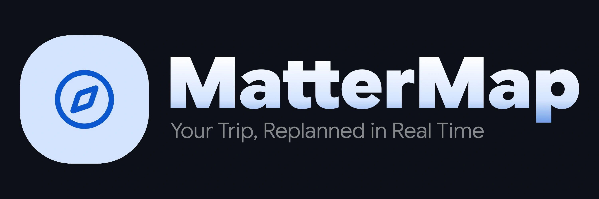

<div align="center">

# 

**A live, adaptive travel itinerary planner.**  
_Ranked Top 50 at AI Riser Vietnam 2026: #BuildwithGoogleAI_

[](https://mattermap.ai.studio)
[](https://ai.google.dev/)
[](https://react.dev/)
[](https://www.typescriptlang.org/)
[](https://tailwindcss.com/)
[](https://maplibre.org/)
[](https://firebase.google.com/)

> Most travel planners generate a schedule and stop there. MatterMap adapts as your trip actually unfolds.

</div>

---

## 🚩 The Problem

Travel plans are usually made once and never change — even when weather changes, you're running late, a queue is too long, or you're just tired. You can ask an AI chatbot to replan, but that means stopping in the middle of your day to type out fresh prompts, re-explain your situation, and manually search for each new pin on a map.

## 💡 The Solution

MatterMap eliminates the need to stop and re-prompt. Instead of making you manually type out updates, it dynamically adapts your route in real time as your day actually unfolds:

- 📍 **Real-World Accuracy:** Stops are cross-checked against OpenStreetMap (Overpass & Photon) to ensure coordinates are actually correct.
- 📸 **Queue Detection:** Point your camera at a long line. Gemini Vision estimates the wait time and automatically suggests a better stop if it threatens your schedule.
- ⏰ **"I'm Late" Button:** Tap once to instantly reshuffle your current stop's timing and find alternatives that fit your new window.
- 🌦️ **Context Aware:** The "Live Pulse" feature tracks your pace and checks real-time weather updates every 30 minutes to keep your plan viable.
- 🗣️ **Voice Control:** Tell the app what you want to change, and the itinerary updates immediately.
- ✨ **The Essentials:** Multi-day planning, an interactive map view, saved accounts, and more!

---

## 🛠️ Tech Stack

| Component / Role                         | Technology                            |
| :--------------------------------------- | :------------------------------------ |
| **Reasoning, Scheduling & Voice**        | Google Gemini                         |
| **Wait-Time Vision Analysis**            | Gemini Vision                         |
| **Map Rendering**                        | MapLibre GL JS + OpenStreetMap tiles  |
| **Place & Operating Hours Verification** | Overpass API                          |
| **Destination Search & Geocoding**       | Photon                                |
| **Frontend & UI**                        | React 19, TypeScript, Tailwind CSS v4 |
| **Auth & Saved Itineraries**             | Firebase Auth & Firestore             |
| **Server & Deployment**                  | Express, Google AI Studio             |

---

## 🏁 Getting Started

### Prerequisites

- [Node.js](https://nodejs.org/) (v18+) or [Bun](https://bun.sh/)
- A [Google Gemini API Key](https://aistudio.google.com/app/apikey)

### Installation

1. **Clone the repository:**

   ```bash
   git clone https://github.com/your-username/mattermap.git
   cd mattermap
   ```

2. **Install dependencies:**

   ```bash
   npm install
   # or with bun:
   bun install
   ```

3. **Configure environment variables:**
   Copy `.env.example` to `.env` and provide your API keys:

   ```bash
   cp .env.example .env
   ```

   Add your Gemini credentials:

   ```env
   GEMINI_API_KEY="your-gemini-api-key"
   APP_URL="http://localhost:3000"
   ```

4. **Start the development server:**

   ```bash
   npm run dev
   # or with bun:
   bun dev
   ```

5. Open [http://localhost:3000](http://localhost:3000) in your browser.

---

## 🚀 Roadmap

- [ ] Integrating real-time crowd and busyness data.
- [ ] Using machine learning on user behavior to improve personalized suggestions.
- [ ] Building a verified local partner network.
- [ ] Launching native iOS and Android apps.
- [ ] Adding a freemium tier (free planning, premium live re-planning).
- [ ] Smart checklist of what to bring, based on your itinerary and weather forecast.

---

## 🏆 Awards & Recognition

MatterMap was born at the **AI Riser Vietnam Hands-On Workshop** and further developed for **AI Riser Vietnam 2026**:

- 🥇 **1st Place** — _Lotus Hack (AI Riser Vietnam Hands-On Workshop)_
- 🏅 **Top 50** — _AI Riser Vietnam 2026: #BuildwithGoogleAI_

<div align="center">
  
</div>

---

## 👥 The Team

MatterMap was created and built by **Troy (me), Ben, Bill and Tele**

---

## 📄 License

This project is licensed under the **MIT License** — see the [LICENSE](LICENSE.md) file for details.
